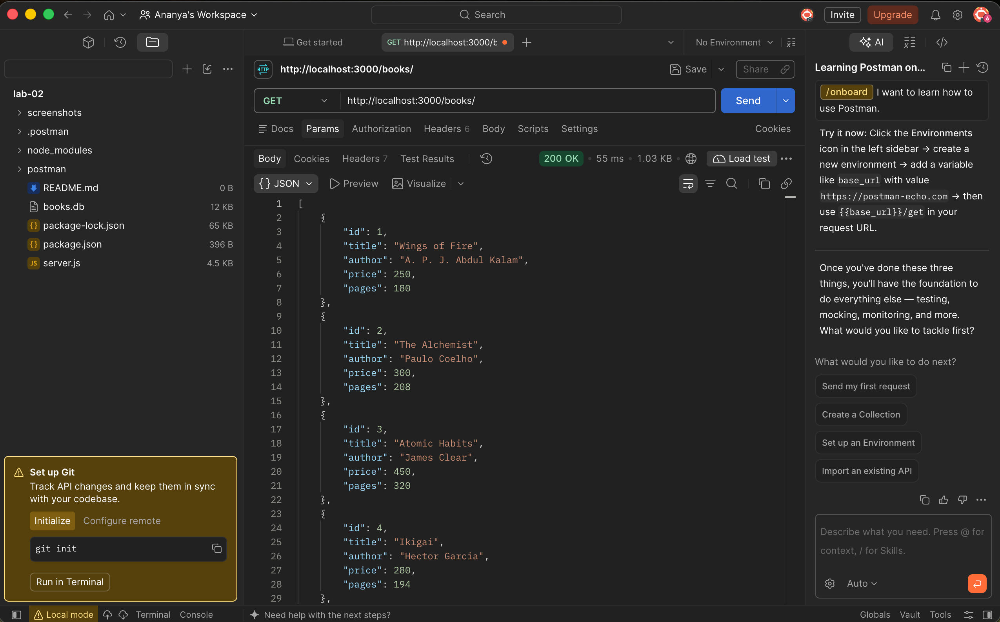
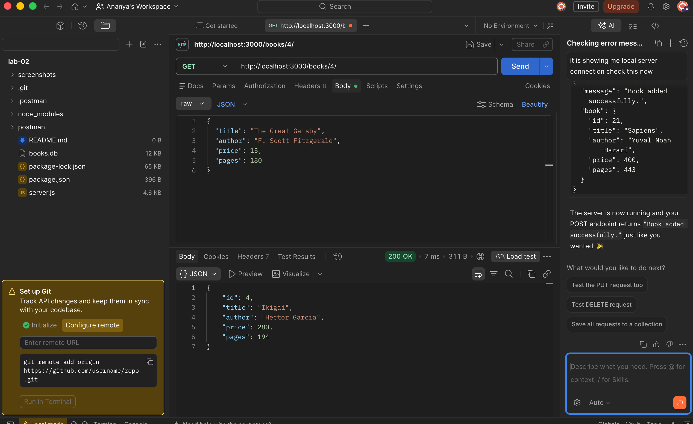
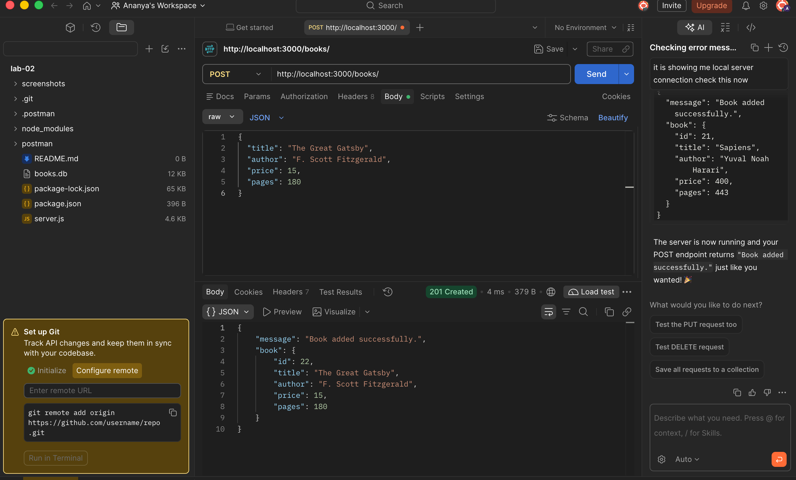
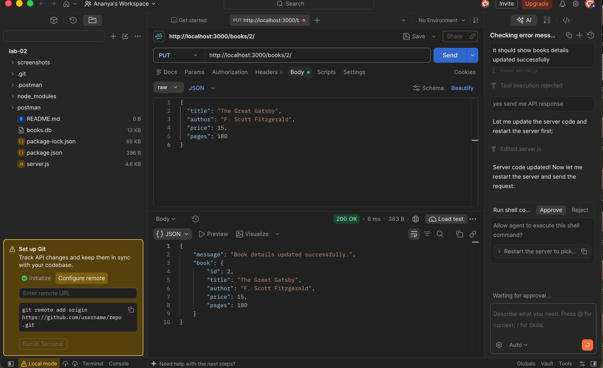
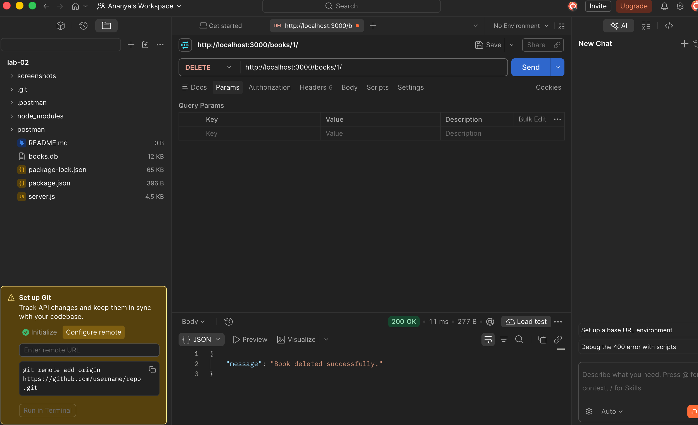

# BDF Lab 02 - Express.js & SQLite CRUD API

A comprehensive backend development lab demonstrating how to build a RESTful CRUD API using Node.js, Express.js, and an SQLite database for managing books.

---

## 🌐 Live Deployment & Localhost Links

- 🔗 **Live Production URL:** [https://labreport2backendd.vercel.app/](https://labreport2backendd.vercel.app/)
- 🔗 **Vercel Mirror URL:** [https://lab-02-fawn.vercel.app/](https://lab-02-fawn.vercel.app/)
- 💻 **Localhost Server:** [http://localhost:3000/](http://localhost:3000/)

### Direct Live API Endpoints (Click to Test)

- 🏠 **API Welcome & Route Guide:** [https://labreport2backendd.vercel.app/](https://labreport2backendd.vercel.app/)
- 📚 **Get All Books (`/books/`):** [https://labreport2backendd.vercel.app/books/](https://labreport2backendd.vercel.app/books/)
- 📖 **Get Book 4 (`/books/4/`):** [https://labreport2backendd.vercel.app/books/4/](https://labreport2backendd.vercel.app/books/4/)

---

## 👤 Author Information

- **Name:** D. Ananya
- **Section:** CSE AIML-2B

---

## 📁 Project Structure

```text
lab-02/
├── api/
│   └── index.js              # Vercel serverless entry point
├── screenshots/              # Postman API test verification screenshots
│   ├── 01-get-all-books.png
│   ├── 02-get-book-by-id.png
│   ├── 03-post-add-book.png
│   ├── 04-put-update-book.png
│   └── 05-delete-book.png
├── .gitignore                # Git ignore file (excludes node_modules, etc.)
├── books.db                  # SQLite database file storing book records
├── package.json              # Project metadata, dependencies & scripts
├── package-lock.json         # Dependency lockfile
├── server.js                 # Express.js REST API server & database operations
├── vercel.json               # Vercel deployment routing configuration
└── README.md                 # Project documentation & verification report
```

---

## 🚀 Getting Started

### Prerequisites

Ensure you have [Node.js](https://nodejs.org/) (v18 or higher recommended) installed.

Check versions:
```bash
node -v
npm -v
```

### Installation

Clone the repository and install dependencies:

```bash
git clone https://github.com/ananya6133-star/Lab_Report_1.git
cd Lab_Report_1
git checkout lab-2
npm install
```

### Running Locally

To start the development server with auto-reload:

```bash
npm run dev
```

To run in standard production mode:

```bash
npm start
```

The server will be running at [http://localhost:3000](http://localhost:3000).

---

## 📡 API Endpoints

| Method | Endpoint | Localhost Link | Live Link | Description | Expected Status |
| :--- | :--- | :--- | :--- | :--- | :--- |
| `GET` | `/` | [Open Localhost](http://localhost:3000/) | [Open Live](https://labreport2backendd.vercel.app/) | Root API welcome message and route index | `200 OK` |
| `GET` | `/books/` | [Open Localhost](http://localhost:3000/books/) | [Open Live](https://labreport2backendd.vercel.app/books/) | Retrieve all books ordered by ID | `200 OK` |
| `GET` | `/books/:bookId/` | [Open Localhost](http://localhost:3000/books/4/) | [Open Live](https://labreport2backendd.vercel.app/books/4/) | Retrieve a single book by ID | `200 OK` |
| `POST` | `/books/` | [Open Localhost](http://localhost:3000/books/) | [Open Live](https://labreport2backendd.vercel.app/books/) | Add a new book to the database | `201 Created` |
| `PUT` | `/books/:bookId/` | [Open Localhost](http://localhost:3000/books/2/) | [Open Live](https://labreport2backendd.vercel.app/books/2/) | Update details of an existing book | `200 OK` |
| `DELETE` | `/books/:bookId/` | [Open Localhost](http://localhost:3000/books/1/) | [Open Live](https://labreport2backendd.vercel.app/books/1/) | Delete a book by ID | `200 OK` |

### Sample Request Payloads

#### `POST /books/`
```json
{
  "title": "Clean Code",
  "author": "Robert C. Martin",
  "price": 500,
  "pages": 464
}
```

#### `PUT /books/:bookId/`
```json
{
  "title": "The Great Gatsby",
  "author": "F. Scott Fitzgerald",
  "price": 15,
  "pages": 180
}
```

---

## 📸 Postman Execution & Verification Screenshots

### 1. GET All Books (`GET /books/`)


---

### 2. GET Book by ID (`GET /books/:bookId/`)


---

### 3. POST Add Book (`POST /books/`)


---

### 4. PUT Update Book (`PUT /books/:bookId/`)


---

### 5. DELETE Book (`DELETE /books/:bookId/`)


---

## 🛠️ Built With

- [Node.js](https://nodejs.org/) - JavaScript runtime environment
- [Express.js](https://expressjs.com/) - Fast, minimalist web framework
- [SQLite3](https://www.sqlite.org/) & [sqlite](https://www.npmjs.com/package/sqlite) - Lightweight disk-based SQL database engine
- [Nodemon](https://nodemon.io/) - Tool for hot-reloading development server
- [Postman](https://www.postman.com/) - API testing and verification platform
